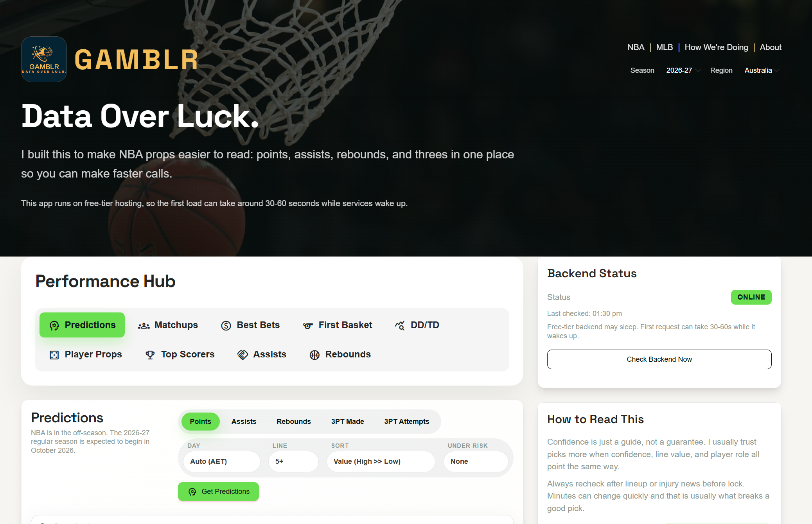
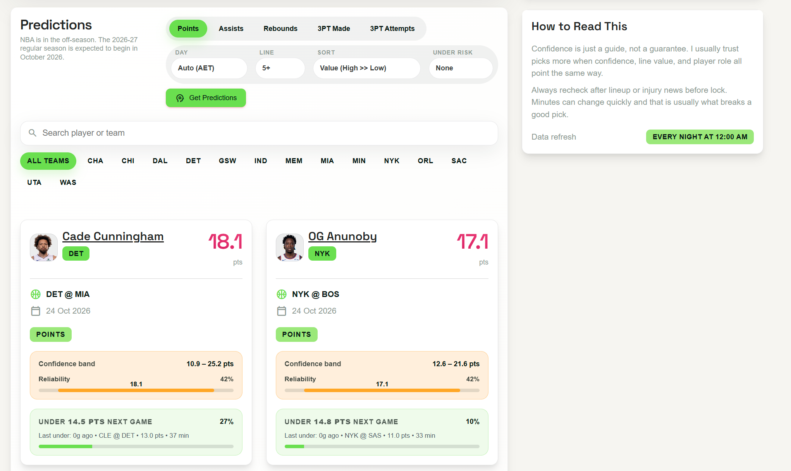
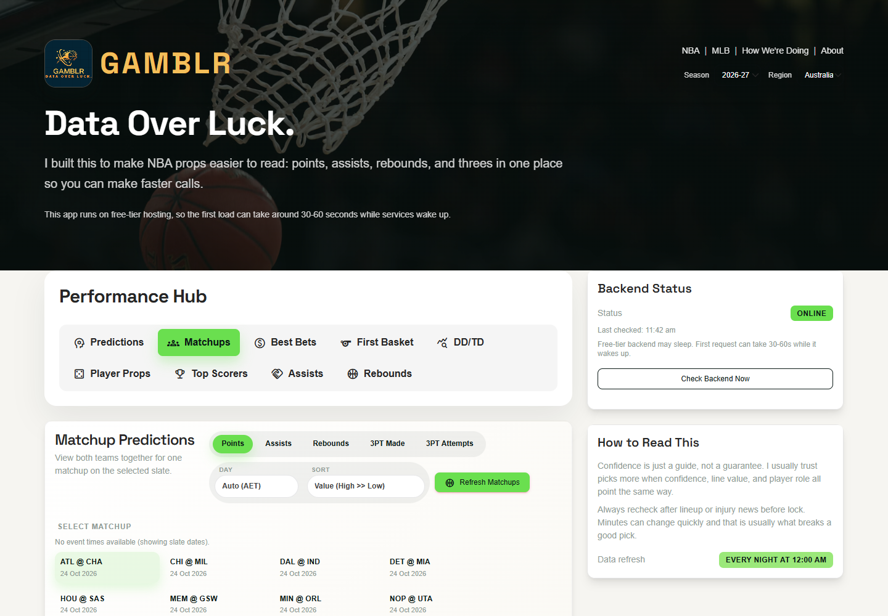
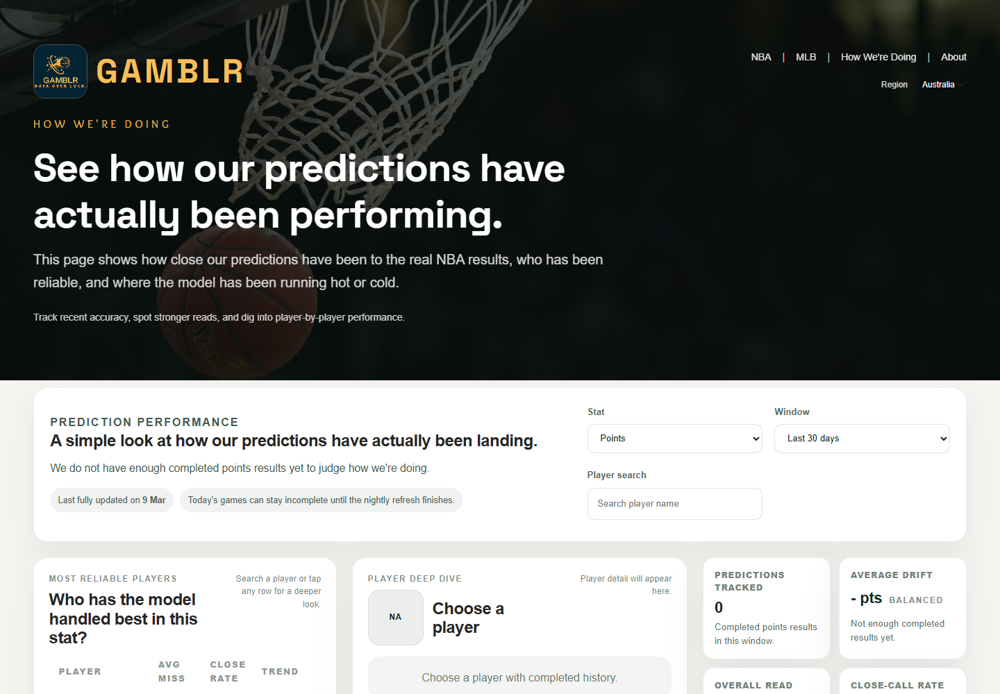
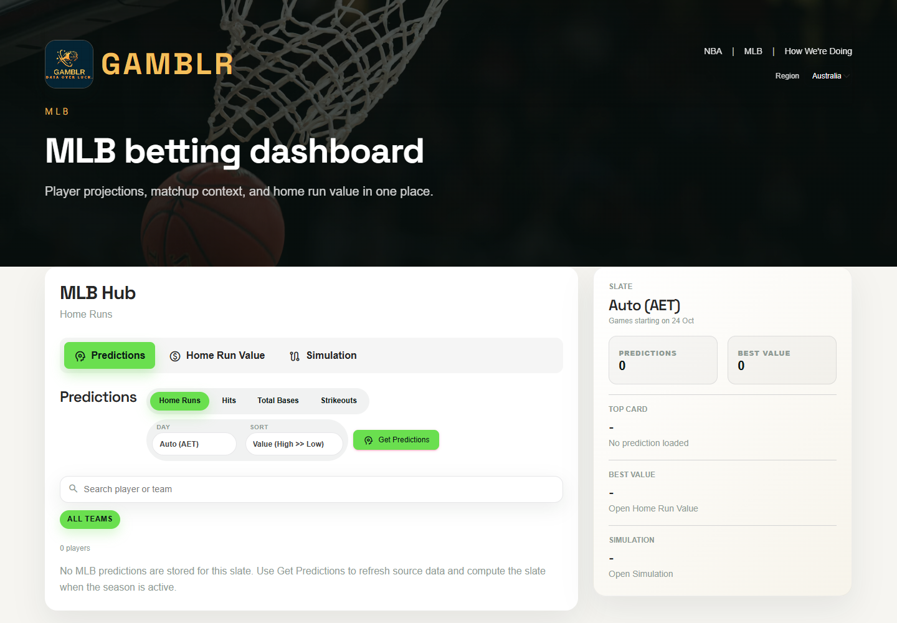
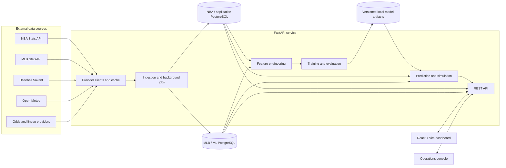

<div align="center">
  
  <h1>Gamblr</h1>
  <p><strong>Sports analytics and probabilistic player projections for the NBA and MLB.</strong></p>
  <p>Gamblr turns schedules, box scores, lineups, Statcast context, weather, and betting markets into a single research workspace for exploring upcoming games and reviewing how past predictions performed.</p>
  <p>
    <a href="https://gamblr.pro/"></a>
    <a href="frontend/"></a>
    <a href="backend/"></a>
    <a href="backend/alembic/"></a>
    <a href="ml/"></a>
  </p>
  <p><a href="https://gamblr.pro/">Open the live dashboard</a> · <a href="#what-gamblr-does">Explore features</a> · <a href="#architecture">View the architecture</a> · <a href="#getting-started">Run locally</a></p>
</div>

> The hosted backend uses a free-tier service and may need 30–60 seconds to wake on the first request.



## Overview

Gamblr is a full-stack sports analytics project spanning data ingestion, relational modeling, feature engineering, model training, inference, backtesting, odds analysis, and a responsive web interface. It currently covers NBA and MLB workflows through one React application and one FastAPI service, while keeping each sport's data and modeling concerns separate.

The platform is designed to answer three practical questions:

- What does the available data suggest for the next slate?
- How uncertain is that estimate, and what context could weaken it?
- How have previous projections compared with completed results?

The output is decision support, not certainty. Prediction bands, reliability labels, lineup context, market freshness, and historical review are surfaced so a point estimate is never the only signal.

## Product showcase

<table>
  <tr>
    <td width="50%" valign="top">
      <strong>NBA player projections</strong><br />
      Points, assists, rebounds, made threes, and attempted threes with slate, team, search, value, and under-risk controls.
      <br /><br />
      
    </td>
    <td width="50%" valign="top">
      <strong>NBA matchup view</strong><br />
      Side-by-side projections for both teams in a selected game, using the same stat and date controls as the player view.
      <br /><br />
      
    </td>
  </tr>
  <tr>
    <td width="50%" valign="top">
      <strong>Prediction review</strong><br />
      Completed-result summaries, recent trends, and player-level drill-downs for checking model behavior over time.
      <br /><br />
      
    </td>
    <td width="50%" valign="top">
      <strong>MLB analytics</strong><br />
      Home run, hit, total-base, and pitcher strikeout projections alongside value grading and game simulation.
      <br /><br />
      
    </td>
  </tr>
</table>

The screenshots are captured from the application itself. The MLB image intentionally shows the supported no-slate state; no prediction data was fabricated for presentation.

## What Gamblr does

### NBA analytics

- **Player projections:** points, assists, rebounds, three-pointers made, and three-point attempts for yesterday, today, or upcoming slates.
- **Matchup analysis:** a game-centered view that combines projections from both teams.
- **Market research:** bookmaker event and player-prop retrieval, prop synchronization, stale-line rejection, ranked best-bet candidates, and parlay construction.
- **Specialty markets:** two-stage first-basket modeling plus double-double and triple-double estimates derived from points, rebounds, and assists prediction distributions.
- **League context:** top scorers, assist leaders, rebound leaders, guard snapshots, recent performers, schedules, and lineup-aware filtering.
- **Prediction review:** overall, trend, recent-result, and per-player endpoints backed by stored prediction logs and actual outcomes.

### MLB analytics

- **Pregame projections:** batter home runs, hits, total bases, and pitcher strikeouts.
- **Home-run value board:** optional PropLine prices combined with model probabilities, implied probability, edge, and fractional-Kelly-derived grading.
- **Game simulation:** configurable, seeded simulations with pitch-by-pitch playback, box scores, projected player lines, venue, weather, lineup, starter, bullpen, and pitch-mix context.
- **Data context:** schedules, rosters, game feeds, umpires, weather snapshots, Statcast batting and pitching data, bat tracking, swing path, and park factors.
- **Evaluation artifacts:** time-based model selection reports and completed-game scoring for supported MLB markets.

### Data and operations

- Idempotent database upserts and Alembic migrations for two PostgreSQL databases.
- Season-aware NBA ingestion with game-level team history preserved across trades.
- Background jobs and progress polling for longer ingestion, precomputation, and training tasks.
- Bounded provider retries, caching, ingestion-run records, and dependency health checks.
- An in-app operations console for NBA/MLB ingestion, prediction precomputation, model training, evaluation, backtests, and recent-row inspection.
- A guided PowerShell setup plus repeatable migration, startup, ingestion, and pipeline scripts.

## Current implementation status

| Area | Status | Notes |
| --- | --- | --- |
| NBA dashboard and statistics | Operational | Live provider reads, database-backed histories, season selection, and slate views are implemented. |
| NBA projections and review | Operational with data prerequisites | Requires migrated databases, historical rows, and compatible local model artifacts. |
| NBA odds and best bets | Optional integration | Requires `THEODDS_API_KEY`; candidates are rejected when events have started or prices are stale. |
| NBA first basket | Data-dependent | Training, inference, labels, and UI exist; current lineup and trained artifacts are required. |
| MLB ingestion and features | Implemented | StatsAPI, Baseball Savant, weather, roster, schedule, and game-context pipelines are present. |
| MLB predictions and simulation | Implemented, slate-dependent | The UI supports all four markets and simulation; an empty state is expected without an ingested active slate. |
| Admin console | Internal operational tooling | Implemented for maintenance workflows; it should not be treated as a hardened, authenticated control plane. |

The legacy `GET /mlb/status` response is still a placeholder marked `planned`; operational MLB readiness is exposed by `/mlb/health` and `/mlb/db/cron/status` instead.

## Technology stack

**Frontend**

- React 19, TypeScript, Vite 7, and CSS
- A typed fetch client with short-lived browser caching
- Playwright for reproducible application screenshots
- Vercel SPA rewrite configuration

**Backend and persistence**

- Python, FastAPI, Uvicorn, Pydantic Settings, and HTTPX
- SQLAlchemy 2 asynchronous sessions with `asyncpg`
- PostgreSQL with Alembic migrations
- In-process TTL caching and background job orchestration

**Machine learning and data**

- pandas, NumPy, scikit-learn, XGBoost, and Joblib
- NBA Stats through `nba_api`
- MLB StatsAPI and Baseball Savant
- Open-Meteo weather and historical forecast data
- Optional The Odds API, SportsData, PropLine, RotoWire, and JediBets integrations

**Delivery and quality**

- Vercel-compatible frontend configuration
- Render-hosted API referenced by the keepalive workflow
- pytest, pytest-asyncio, ESLint, TypeScript, and production builds
- GitHub Actions keepalive workflow for free-tier backend availability

## Architecture



### Data flow

1. Provider clients fetch schedules, box scores, lineups, odds, Statcast data, weather, and supporting context.
2. Ingestion services normalize upstream payloads and upsert them into the appropriate PostgreSQL database.
3. Feature pipelines construct shifted rolling history, team/opponent context, lineup aggregates, player availability, and sport-specific environmental features.
4. Training jobs perform chronological validation and serialize dated artifacts under `ml/models/` (ignored by Git).
5. Inference services combine saved artifacts with the selected slate and persist prediction logs for later evaluation.
6. FastAPI exposes statistics, predictions, simulations, review data, health, and operational jobs to the React client.

## Machine learning and predictions

### NBA models

The primary NBA stat models are five-seed XGBoost regression ensembles. Separate models cover minutes, points, assists, rebounds, made threes, and attempted threes. The ensemble median is used as the central estimate, and held-out absolute residuals provide calibration information for prediction bands.

Features are built only from information available before the predicted game. They include:

- shifted 5- and 10-game player form, variability, and per-minute production;
- projected minutes, rest, back-to-backs, home/away status, and current-season sample size;
- rolling team output and opponent-allowed statistics;
- lineup pace, net rating, assist percentage, and rebound percentage;
- aggregate teammate production and usage; and
- team-change flags and games since a trade or roster change.

Training uses a chronological 80/20 date split and reports MAE and RMSE. A separate walk-forward backtest retrains only on dates preceding each test slate. First-basket predictions use two time-split XGBoost classifiers: one for which team scores first and another for the first scorer. Their artifacts report Brier score and log loss.

The UI's **reliability** value is not a win probability. It is adjusted using prior errors and capped when current-season history is limited or a team change is detected. Double-double and triple-double figures are an independence approximation over marginal stat probabilities, not a dedicated joint-outcome model.

### MLB models

MLB training uses date-based holdouts and evaluates XGBoost and random-forest candidates when model search is enabled. Home runs are treated as a classification problem; hits, total bases, and pitcher strikeouts are regression problems.

The feature pipeline incorporates player rolling form, platoon and opponent context, expected statistics, pitch and batted-ball profiles, bullpen history, park factors, weather, calendar effects, bat tracking, and swing-path measurements where available. Home-run physics helpers model batted-ball outcomes separately and can enrich the pregame frame.

Classification artifacts report Brier score, log loss, ROC AUC, and average precision where defined. Regression artifacts report MAE and RMSE. Reports in `ml/reports/mlb/` are historical training outputs; this README deliberately does not present one of them as a current production benchmark.

## Getting started

### Prerequisites

- Windows PowerShell for the maintained setup scripts
- Python 3.13 and [`uv`](https://docs.astral.sh/uv/)
- Node.js 20.19+ (or 22.12+) and npm
- PostgreSQL 16+ with `psql` and `createdb` on `PATH`

### 1. Clone and install

```powershell
git clone https://github.com/klutzyk/gamblr.git
Set-Location gamblr
.\scripts\setup_windows.ps1
```

The setup script creates `.venv`, installs Python development dependencies, runs `npm ci`, and creates local `.env` files from the committed examples when they do not already exist.

### 2. Configure the environment

Review `.env` and `frontend/.env` before starting the application. The committed examples contain local-only defaults and blank optional keys.

| Variable | Purpose | Required |
| --- | --- | --- |
| `DATABASE_URL` | NBA/application PostgreSQL connection | Yes |
| `ML_DATABASE_URL` | MLB/ML PostgreSQL connection | Yes |
| `CORS_ORIGINS` | Browser origins accepted by FastAPI | Yes |
| `VITE_API_BASE_URL` | Backend URL used by the browser | Yes |
| `THEODDS_API_KEY` | NBA events, prices, and player props | Optional |
| `SPORTSDATA_API_KEY` | Additional NBA provider functions | Optional |
| `PROPLINE_API_KEY` | MLB prop pricing and value board | Optional |

Never commit `.env`, credentials, hosted database URLs, or model-provider secrets.

### 3. Create and migrate local databases

```powershell
.\scripts\create_local_databases.ps1
.\scripts\migrate.ps1
```

The first script creates `gamblr` and `gamblr_ml` if missing. The migration script upgrades both configured databases and refuses to target a host other than `localhost`, `127.0.0.1`, or `::1`.

### 4. Start the application

```powershell
.\scripts\start_dev.ps1
```

- Web app: <http://127.0.0.1:5173>
- OpenAPI documentation: <http://127.0.0.1:8000/docs>
- Dependency health: <http://127.0.0.1:8000/health/dependencies>

The script launches both processes and prints their process IDs plus the command needed to stop them.

<details>
<summary><strong>Start each service manually</strong></summary>

Backend, from the repository root:

```powershell
Set-Location backend
..\.venv\Scripts\python.exe -m uvicorn app.main:app --reload --host 127.0.0.1 --port 8000
```

Frontend, in a second terminal:

```powershell
Set-Location frontend
npm run dev -- --host 127.0.0.1
```

</details>

### 5. Load data and build model artifacts

No ingestion, migration, or training runs automatically on application startup. A bounded NBA load can be started explicitly:

```powershell
.\scripts\ingest_nba.ps1 -Season 2026-27 -Since 2026-10-22 -Until 2026-10-22
```

After sufficient historical data is available, the API exposes rolling-feature refresh, training, evaluation, and walk-forward backtest routes under `/ml`. The interactive pipeline runner coordinates those steps and asks before each material operation:

```powershell
.\.venv\Scripts\python.exe .\scripts\run_pipeline.py --season 2026-27
```

MLB bootstrap ingestion, precomputation, training, and odds refreshes are available through the operations console and `/mlb/*` routes. They are intentionally user-triggered because they can be long-running and depend on external providers.

## Project structure

```text
gamblr/
├── backend/
│   ├── alembic/              # PostgreSQL schema migrations
│   └── app/
│       ├── api/              # NBA, MLB, odds, health, review, and ML routes
│       ├── core/             # Settings, seasons, constants, and safety rules
│       ├── db/               # Sessions, queries, and persistence services
│       ├── models/           # SQLAlchemy models
│       └── services/         # Provider clients, caching, lineups, and simulation
├── frontend/
│   ├── scripts/              # Playwright screenshot capture
│   └── src/                  # React pages, API client, and styling
├── ml/
│   ├── nba/                  # Features, training, inference, and backtests
│   ├── mlb/                  # Features, models, evaluation, and pregame scoring
│   ├── notebooks/            # Exploratory analysis
│   └── reports/mlb/          # Historical evaluation reports
├── docs/screenshots/         # README product imagery
├── scripts/                  # Setup, migration, ingestion, and pipeline helpers
├── .env.example
└── requirements-dev.txt
```

Generated model files live under ignored `ml/models/` paths and must be trained or supplied separately on a new clone. `backup.dump` is a PostgreSQL custom-format archive; inspect it with `pg_restore --list` and restore only into a new, isolated local database if it is needed.

## Development and validation

Run backend tests and syntax compilation from the repository root:

```powershell
.\.venv\Scripts\python.exe -m pytest -q
.\.venv\Scripts\python.exe -m compileall -q backend ml scripts
```

Run frontend checks:

```powershell
Push-Location frontend
npm run lint
npm run build
Pop-Location
```

The current backend suite covers NBA season boundaries and validation, response normalization, ingestion idempotency, database URL handling, missing/limited prediction data, reliability caps, and odds safety. The screenshot gallery can be regenerated while both development servers are running with:

```powershell
Push-Location frontend
npm run screenshots
Pop-Location
```

## Roadmap

The project is actively developed. The most useful next engineering steps, based on the current repository, are:

- replace the legacy placeholder MLB status response with the operational readiness model already used by the admin console;
- add automated MLB ingestion/model tests and browser-level tests for critical dashboard flows;
- run lint, build, and test checks in CI in addition to the existing backend keepalive workflow;
- formalize model registry metadata, promotion criteria, and drift monitoring across both sports; and
- harden authentication and authorization before treating the operations console as a public production control plane.

## Disclaimer

Gamblr is an analytics and software-engineering project. Its projections are probabilistic estimates based on incomplete, time-sensitive data and do not guarantee player performance or betting outcomes. Lineups, injuries, weather, prices, sample size, and model drift can materially change a result. Nothing in this repository is financial or wagering advice.

---

<div align="center">
  <strong>Data over luck.</strong><br />
  <a href="https://gamblr.pro/">gamblr.pro</a> · <a href="https://github.com/klutzyk/gamblr">GitHub repository</a>
</div>
